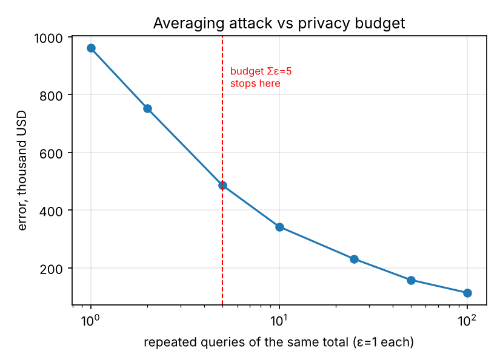

# canton-dp-aggregates

**Can a private market on Canton publish aggregate statistics without leaking its participants' positions?**

Canton keeps transactions private, but markets need public signals: volume, supply, prices.
The obvious answer, "publish only totals", leaks: in a thin market, participants can subtract
what they know from the total and recover a competitor's numbers. This repo measures that leak
and how much differential privacy (DP) fixes it, as groundwork for a Daml implementation that
enforces the privacy budget on-ledger (Dev Fund RFP *Public verifiability*).

## Run

```bash
pip install -e ".[dev]"
pytest                                            # 13 tests
PYTHONPATH=src python -m cdp.experiments --out results --seeds 200   # ~6 s
```

## Setup

Synthetic market (illustrative, not measured on Canton): 3 dealers, 22 trading days,
~20 trades per dealer per day, trade size log-normal with 250k USD median → a dealer-day ≈ 6M,
a market-day ≈ 18M. Laplace mechanism, 200 random markets per data point.

Two **privacy units** (what is hidden):

| unit | hides | sensitivity Δ |
|---|---|---|
| `trade` | any single trade | 1M (trades clipped at 1M) |
| `dealer_day` | a dealer's entire daily volume | 12M (dealer-days clipped at 12M) |

## Findings

**1. Exact totals leak completely.**
If 2 of 3 dealers compare notes, they recover the third dealer's daily volume on **100%** of days.
Even a single insider in a market where dealers trade on 60% of days recovers a competitor's
exact volume on **~49%** of days (the days only one other dealer traded).

**2. "ε = 1" means different protection depending on the privacy unit.** At ε = 1, daily releases, 3 dealers:

| unit | error of published total | victim days recovered within ±10% |
|---|---|---|
| none (exact) | 0% | 100% |
| `trade` | **6.3%** | 42% |
| `dealer_day` | 43% | **5.7%** |

Plotted as error against leakage, both units trace the **same curve**: a dealer's exposure
depends only on the noise scale relative to its volume. Trade-level ε = 1 (Δ = 1M) adds the same
noise as dealer-level ε = 12, so for a dealer's day it is a weak guarantee in disguise. Clipping adds
a floor: trade-level releases cannot get closer than ~4% to the true total. All errors here are measured
against the true, unclipped totals.


**3. Dealer-level privacy gets affordable as the market grows** (ε = 1, daily):
3 dealers → 42% error, 10 → 13%, 20 → **6.3%**, 50 → 2.6%.


**4. Coarser releases help, if the clip bound is retuned.** Same ε = 1, trade level:
daily total 6.1% error → monthly total **0.9%** with a 2M clip bound (a month accumulates clipping bias).

**5. Without a budget, noise can be averaged away.** Re-querying the same total 100 times
cuts the attacker's error from ~960k to ~114k USD (√k law). An accountant with Σε ≤ 5 blocks
every attempt beyond 5 queries. On Canton this accountant should be a Daml contract, so no
single operator can quietly exceed it.



**6. Daily snapshots of running totals need continual-release DP.** A cap-table feed that
publishes total shares every day reveals each new grant as the day-over-day difference (100%).
Adding Lap(C/ε) to every snapshot *looks* cheap (2.4% error at "ε = 5") but each grant sits in
every later snapshot, so the real cost is 64·ε, and an attacker who averages snapshots recovers
30% of grants. With the budget honestly accounted (ε = 5 over 64 days):

| mechanism | error of published total | grants recovered (strong attack) |
|---|---|---|
| noise split evenly over days | 17.0% | 1.6% |
| **binary-tree mechanism** | **4.8%** | 2.1% |

**7. The clip bound trades bias against noise.** Cap table, tree, ε = 5: bound 50k → 5.4% error,
100k → 4.5%, 200k → 4.8%, 1M → 19%. Choose it from public or earlier-period data, never from the
released data itself.


**8. Robustness (E8).** Changing one assumption at a time (trades per day, tail weight, trade size,
participation; grant rate, grant tails, horizon), with clip bounds set by a fixed public rule:

- holds everywhere: dealer-day ε=1 exposes a dealer's day < 6% of the time; dealer-day protection
  is 6-7x cheaper with 20 dealers than with 3; the tree beats an even split by 2.2-4.7x; unaccounted
  per-day noise leaks 22-42% of grants under averaging.
- does **not** hold everywhere: trade-level ε=1 exposes a dealer's day 41% of the time at 20 trades a
  day, 69% at 50, but only 15% at 5. A trade-level guarantee covers a dealer-day only as k·ε for
  k trades (group privacy). With heavy-tailed trades (σ = 1.5) the simple clip rule costs 38% accuracy.
- trade size alone changes nothing (the setup is scale-invariant), a sanity check.

## What this suggests for Canton

- Publish trade-level DP aggregates **daily** and dealer-level DP aggregates only for
  markets with ≳ 20 participants or over longer windows.
- Track ε on-ledger (`PrivacyBudget` contract); refuse releases that exceed it.
- Noise must be generated outside Daml (it is deterministic) — e.g. commit-reveal between
  aggregator and auditor; DP protects participants from each other, it does not by itself prove
  the aggregator computed honestly (TEE/ZK territory, per the RFP).

## Layout

```
src/cdp/
  data.py         synthetic market generator; shapes (T, D)
  dp.py           clipping, Laplace mechanism, PrivacyAccountant
  attacks.py      coalition, sparse-insider, averaging and snapshot attacks
  captable.py     cap-table model + binary-tree continual release
  experiments.py  E1–E5 → CSV + figures in results/
tests/test_cdp.py
```

## License

Apache-2.0
