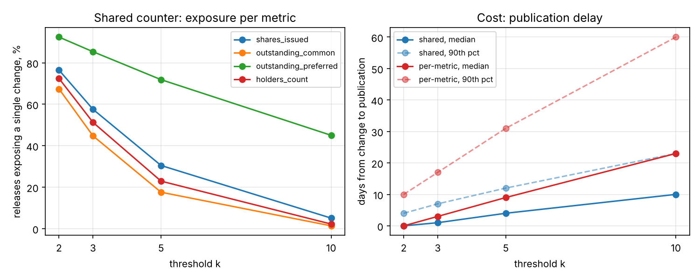
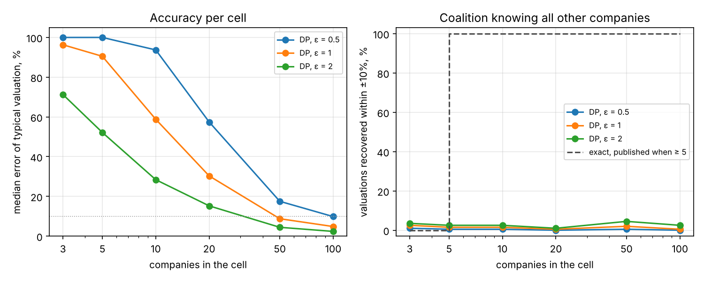
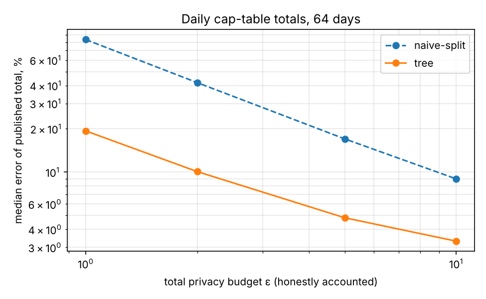

# canton-dp-aggregates

**Article:** [Private Markets, Public Numbers: Thresholds and Differential Privacy for Aggregates on Canton](article/article.md) (draft). Every number in it comes from the experiments below.

**Can a private market on Canton publish aggregate statistics without leaking its participants' positions?**

Canton keeps transactions private, but markets need public signals: volume, supply, prices.
The obvious answer, "publish only totals", leaks: in a thin market, participants can subtract
what they know from the total and recover a competitor's numbers. This repo measures that leak
and how much differential privacy (DP) fixes it, as groundwork for a Daml implementation that
enforces the privacy budget on-ledger (Dev Fund RFP *Public verifiability*).

## Run

```bash
pip install -e ".[dev]"
pytest                                            # 25 tests
PYTHONPATH=src python -m cdp.experiments --out results --seeds 200   # ~15 s
```

## Setup

Synthetic market (illustrative, not measured on Canton): 3 dealers, 22 trading days,
~20 trades per dealer per day, trade size log-normal with 250k USD median → a dealer-day ≈ 6M,
a market-day ≈ 18M. Laplace mechanism, 200 random markets per data point.

Two **privacy units** (what is hidden):

| unit | hides | sensitivity Δ |
|---|---|---|
| `trade` | any single trade | 1M (trades clipped at 1M) |
| `dealer_day` | a dealer's entire daily volume | 12M (dealer-days clipped at 12M) |

## Findings

**1. Exact totals leak completely.**
If 2 of 3 dealers compare notes, they recover the third dealer's daily volume on **100%** of days.
Even a single insider in a market where dealers trade on 60% of days recovers a competitor's
exact volume on **~49%** of days (the days only one other dealer traded).

**2. "ε = 1" means different protection depending on the privacy unit.** At ε = 1, daily releases, 3 dealers:

| unit | median error of published total | 90th-percentile error | victim days recovered within ±10% |
|---|---|---|---|
| none (exact) | 0% | 0% | 100% |
| `trade` | **6.3%** | 16% | 42% |
| `dealer_day` | 43% | 133% | **5.7%** |

The error is a median over days: one day in ten is worse than the 90th-percentile column.

Plotted as error against leakage, both units trace the **same curve**: a dealer's exposure
depends only on the noise scale relative to its volume. Trade-level ε = 1 (Δ = 1M) adds the same
noise as dealer-level ε = 12, so for a dealer's day it is a weak guarantee in disguise. Clipping adds
a floor: trade-level releases cannot get closer than ~4% to the true total. All errors here are measured
against the true, unclipped totals.


**3. Dealer-level privacy gets affordable as the market grows** (ε = 1, daily):
3 dealers → 42% error, 10 → 13%, 20 → **6.3%**, 50 → 2.6%.


**4. Coarser releases help, if the clip bound is retuned.** Same ε = 1, trade level:
daily total 6.1% median error → monthly total **0.8%** with a 2M clip bound (a month accumulates clipping bias).
Protecting a dealer's whole month does not help: Δ and the total both grow 22x, so the median error stays
about where it was (36% monthly against 42% daily; the two agree within sampling noise).

**5. Without a budget, noise can be averaged away.** Re-querying the same total 100 times
cuts the attacker's error from ~960k to ~114k USD (√k law). An accountant with Σε ≤ 5 blocks
every attempt beyond 5 queries. On Canton this accountant should be a Daml contract, so no
single operator can quietly exceed it.


**6. Daily snapshots of running totals need continual-release DP.** A cap-table feed that
publishes total shares every day reveals each new grant as the day-over-day difference (100%).
Adding Lap(C/ε) to every snapshot *looks* cheap (2.4% error at "ε = 5") but each grant sits in
every later snapshot, so the real cost is 64·ε, and an attacker who averages snapshots recovers
30% of grants. With the budget honestly accounted (ε = 5 over 64 days):

| mechanism | error vs total | error in shares | error vs shares issued | grants recovered (day-over-day / strong attack) |
|---|---|---|---|---|
| noise split evenly over days | 17.0% | 1.84M | 118% | 0.2% / 1.6% |
| binary-tree mechanism | 4.8% | 529k | 34% | 1.9% / 2.1% |
| **noise on each day's new shares** | **3.1%** | **347k** | **22%** | 17% / 4.4% |

The simplest honest mechanism wins on a 64-day stream: a grant touches one daily increment, so Lap(C/ε)
on each increment costs ε in total and the running sum carries √t noises instead of the tree's
log-many large ones. It is also the least noisy, so the day-over-day attack recovers more grants (17%):
same ε, a tighter mechanism. The error is quoted three ways because the 10M starting total is public:
4.8% of the total is a third of everything issued in the period.

**6b. Which mechanism for which stream length (E9, ε = 5).** Median error of the running total, in shares:

| days | even split | tree | increments | shares cut by the 200k clip |
|---|---|---|---|---|
| 32 | 956k | 433k | **263k** | 308k |
| 64 | 1.87M | 570k | **406k** | 546k |
| 256 | 7.3M | 1.20M | 1.15M | 2.0M |
| 1024 | 28.6M | 4.6M | 4.4M | 8.9M |

In pure noise the tree overtakes increment noise only somewhere past 1,000 days. Long before that the
error is driven by clipping: about a third of issued shares exceed the bound, they are never added back,
and a running total drifts further below the truth the longer the feed runs. For a supply figure this is
the real limit of the approach, not the choice of mechanism.

**6c. One aggregate over many registers: a threshold against DP (E10).** The Canton Asset Data Feed
proposal (PR #890) publishes a single daily equity aggregate across all registers and applies a
suppression rule (`min-count-5`) to daily changes. Modelled here with R registers, 0.15 grants a day
each, 64 days. "Error" is the median error of the published level against shares issued so far;
"recovered" is the share of grants an attacker gets within ±10%.

| registers | rule | error | outsider | one register | all-but-one coalition |
|---|---|---|---|---|---|
| 5 | exact daily level | 0% | 48% | 56% | 100% |
| 5 | level moves only when 5 grants are pending | 6.1% | 0% | 0.4% | 100% of released grants |
| 5 | DP ε = 5, clip 1M | 33% | 5.1% | 5.3% | 7.5% |
| 20 | exact daily level | 0% | 5.9% | 6.8% | 100% |
| 20 | level moves only when 5 grants are pending | 0.4% | 0% | 0% | 100% of released grants |
| 20 | DP ε = 5, clip 1M | 9.1% | 1.8% | 2.0% | 7.1% |
| 50 | DP ε = 5, clip 1M | 4.0% | 0.3% | 0.3% | 6.9% |

- Suppressing only the *change* item while the level is still published daily protects nothing: the
  change is the difference of two levels. That is the "exact daily level" row.
- A threshold that holds the level back until five grants are pending is close to free with 20 registers
  and stops an outsider and a single register almost completely. It gives no protection against a
  party that knows the other grants in the batch, the threat model DP is built for.
- DP is the only rule that bounds the coalition, and for a supply figure it is expensive: clipping at
  200k loses a third of issued shares at any scale; clipping at 1M needs dozens of registers.

So for this feed a batching threshold is the better first tool, and DP earns its cost where
contributors are few and each knows its own share of the total, as in the dealer market above.

**6d. Threshold release on several metrics: count per metric (E11).** A rule "publish once k changes
are pending" protects a metric only if the k changes are counted *for that metric*. With one counter
shared by all change types, a release triggered by 4 conversions + 1 issuance publishes a
`shares_issued` delta that is exactly that one issuance. One synthetic company over a year (issuance
0.15/day, secondary transfers 0.20, conversions 0.05, preferred rounds 0.01; a change moves
`holders_count` half the time), 200 runs, share of metric releases that expose a single change:

| k | shared counter | `outstanding_preferred` alone | per-metric counter | median delay, shared → per-metric |
|---|---|---|---|---|
| 3 | 56% | 85% | 0% | 1 → 3 days |
| 5 | 32% | 72% | 0% | 4 → 9 days |
| 10 | 12% | 45% | 0% | 10 → 23 days |

At k = 5 with a shared counter, 98% of metric releases mix fewer than k changes. Per-metric (and
per-class) counters remove the exposure by construction; the cost is delay, largest for rare
metrics: preferred stock changes ~0.06 times a day, so at k = 5 it moves roughly every 80 days.
Not covered: differences across metrics (Δ`outstanding_common` − Δ`shares_issued` isolates
conversions) and the release timing itself.



**6e. Breakdowns by segment: DP per cell (E12).** Can a publisher with many cap tables release a
typical valuation per segment (sector x stage) instead of one aggregate? Privacy unit = one company;
cells are disjoint, so each gets the full ε (split between a noisy count and a noisy sum of clipped
log-valuations, range 1M-1B USD). Valuations log-normal, median 20M; 200 runs.

| companies in cell | ε = 0.5 | ε = 1 | ε = 2 | exact, published when ≥ 5 |
|---|---|---|---|---|
| 5 | 100% | 91% | 52% | 0% error, coalition recovers 100% |
| 20 | 57% | 30% | 15% | 0% error, coalition recovers 100% |
| 50 | 18% | 8.8% | 4.4% | 0% error, coalition recovers 100% |
| 100 | 9.8% | 4.8% | 2.4% | 0% error, coalition recovers 100% |

(median error of the typical valuation; under DP a coalition that knows every other company in the
cell recovers the target within ±10% in under 5% of runs at any size.) Share of cells within 10% at
ε = 1, companies spread unevenly over the cells:

| companies | 5 cells | 20 cells |
|---|---|---|
| 100 | 21% | 7% |
| 300 | 47% | 18% |
| 1,000 | 77% | 41% |

DP breakdowns are useful from about 50 companies per cell: coarse segments for a publisher with
hundreds of companies, fine ones only at thousands. A count threshold publishes almost every cell
exactly, and gives a coalition the target's valuation exactly.



**7. The clip bound trades bias against noise.** Cap table, tree, ε = 5: bound 50k → 5.4% error,
100k → 4.5%, 200k → 4.8%, 1M → 19%. Choose it from public or earlier-period data, never from the
released data itself.



**8. Robustness (E8).** Changing one assumption at a time (trades per day, tail weight, trade size,
participation; grant rate, grant tails, horizon), with clip bounds set by a fixed public rule:

- holds everywhere: dealer-day ε=1 exposes a dealer's day < 6% of the time; dealer-day protection
  is 6-7x cheaper with 20 dealers than with 3; the tree beats an even split by 2.2-4.7x; unaccounted
  per-day noise leaks 22-42% of grants under averaging.
- does **not** hold everywhere: trade-level ε=1 exposes a dealer's day 41% of the time at 20 trades a
  day, 69% at 50, but only 15% at 5. A trade-level guarantee covers a dealer-day only as k·ε for
  k trades (group privacy). With heavy-tailed trades (σ = 1.5) the simple clip rule costs 38% accuracy.
- trade size alone changes nothing (the setup is scale-invariant), a sanity check.

## What this suggests for Canton

- Publish trade-level DP aggregates **daily** and dealer-level DP aggregates only for
  markets with ≳ 20 participants or over longer windows.
- Track ε on-ledger (`PrivacyBudget` contract); refuse releases that exceed it.
- Noise must be generated outside Daml (it is deterministic) — e.g. commit-reveal between
  aggregator and auditor; DP protects participants from each other, it does not by itself prove
  the aggregator computed honestly (TEE/ZK territory, per the RFP).

## Layout

```
src/cdp/
  data.py         synthetic market generator; shapes (T, D)
  dp.py           clipping, Laplace mechanism, PrivacyAccountant
  attacks.py      coalition, sparse-insider, averaging and snapshot attacks
  captable.py     cap-table model + continual release (binary tree, increment noise)
  registers.py    one aggregate over many registers: threshold suppression against DP
  threshold.py    threshold release on several metrics: shared vs per-metric counters
  segments.py     per-segment statistics: DP per cell against a count threshold
  sensitivity.py  E8 robustness scenarios
  experiments.py  E1–E7, E9–E12 → CSV + figures in results/
tests/test_cdp.py
```

## License

Apache-2.0
