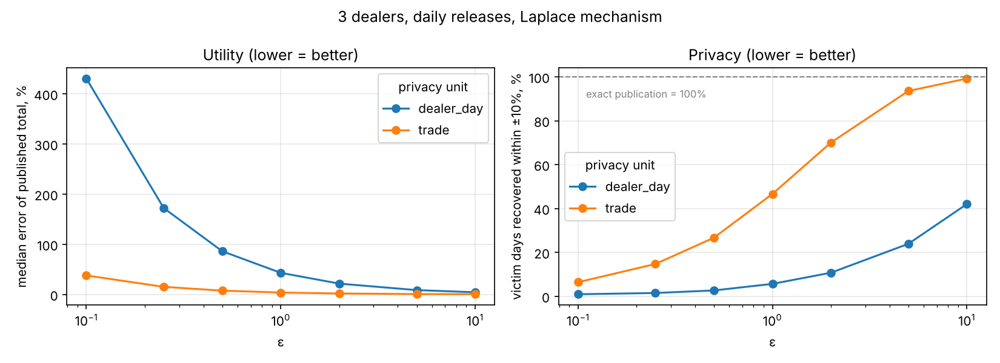
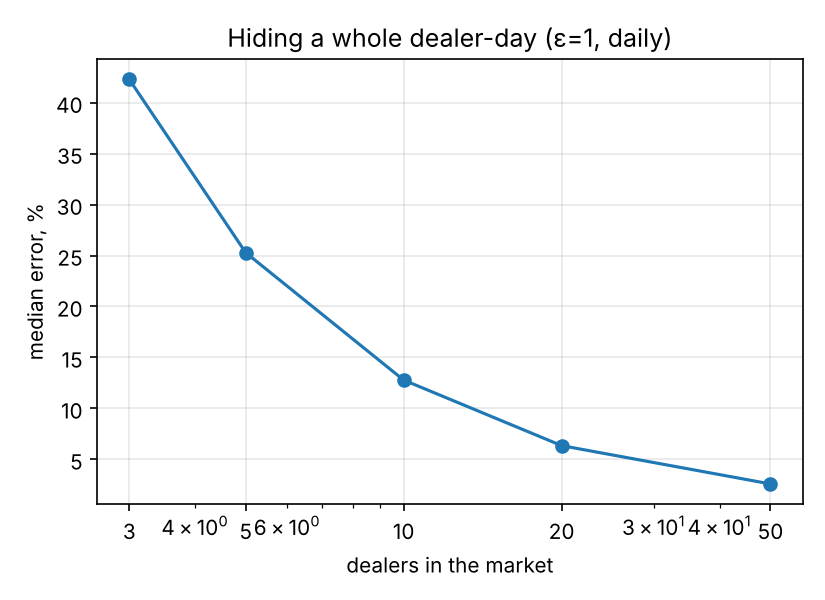

# canton-dp-aggregates

**Can a private market on Canton publish aggregate statistics without leaking its participants' positions?**

Canton keeps transactions private, but markets need public signals: volume, supply, prices.
The obvious answer, "publish only totals", leaks: in a thin market, participants can subtract
what they know from the total and recover a competitor's numbers. This repo measures that leak
and how much differential privacy (DP) fixes it, as groundwork for a Daml implementation that
enforces the privacy budget on-ledger (Dev Fund RFP *Public verifiability*).

## Run

```bash
pip install -e ".[dev]"
pytest                                            # 8 tests
PYTHONPATH=src python -m cdp.experiments --out results --seeds 200   # ~5 s
```

## Setup

Synthetic market (illustrative, not measured on Canton): 3 dealers, 22 trading days,
~20 trades per dealer per day, trade size log-normal with 250k USD median → a dealer-day ≈ 6M,
a market-day ≈ 18M. Laplace mechanism, 200 random markets per data point.

Two **privacy units** (what is hidden):

| unit | hides | sensitivity Δ |
|---|---|---|
| `trade` | any single trade | 1M (trades clipped at 1M) |
| `dealer_day` | a dealer's entire daily volume | 12M (dealer-days clipped at 12M) |

## Findings

**1. Exact totals leak completely.**
If 2 of 3 dealers compare notes, they recover the third dealer's daily volume on **100%** of days.
Even a single insider in a market where dealers trade on 60% of days recovers a competitor's
exact volume on **~49%** of days (the days only one other dealer traded).

**2. "ε = 1" means different protection depending on the privacy unit.** At ε = 1, daily releases, 3 dealers:

| unit | error of published total | victim days recovered within ±10% |
|---|---|---|
| none (exact) | 0% | 100% |
| `trade` | **3.8%** | 47% |
| `dealer_day` | 43% | **5.6%** |

Plotted as error against leakage, both units trace the **same curve**: a dealer's exposure
depends only on the noise scale relative to its volume. Trade-level ε = 1 (Δ = 1M) adds the same
noise as dealer-level ε = 12, so for a dealer's day it is a weak guarantee in disguise. Choosing a
setting means choosing a point on that curve; publish the noise scale with every release, not only ε.



**3. Dealer-level privacy gets affordable as the market grows** (ε = 1, daily):
3 dealers → 42% error, 10 → 13%, 20 → **6.3%**, 50 → 2.5%.



**4. Coarser releases are nearly free for trade-level privacy.** Same ε = 1:
daily total 3.7% error → monthly total **0.2%**.

**5. Without a budget, noise can be averaged away.** Re-querying the same total 100 times
cuts the attacker's error from ~960k to ~114k USD (√k law). An accountant with Σε ≤ 5 blocks
every attempt beyond 5 queries. On Canton this accountant should be a Daml contract, so no
single operator can quietly exceed it.


## What this suggests for Canton

- Publish trade-level DP aggregates **daily** and dealer-level DP aggregates only for
  markets with ≳ 20 participants or over longer windows.
- Track ε on-ledger (`PrivacyBudget` contract); refuse releases that exceed it.
- Noise must be generated outside Daml (it is deterministic) — e.g. commit-reveal between
  aggregator and auditor; DP protects participants from each other, it does not by itself prove
  the aggregator computed honestly (TEE/ZK territory, per the RFP).

## Layout

```
src/cdp/
  data.py         synthetic market generator; shapes (T, D)
  dp.py           clipping, Laplace mechanism, PrivacyAccountant
  attacks.py      coalition, sparse-insider and averaging attacks
  experiments.py  E1–E5 → CSV + figures in results/
tests/test_cdp.py
```

## License

Apache-2.0
