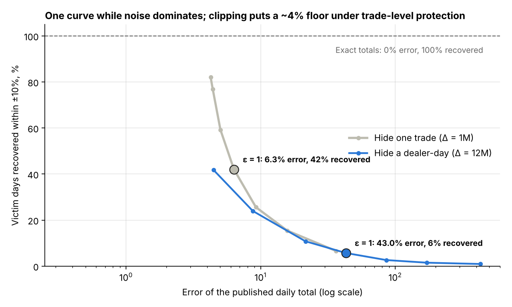
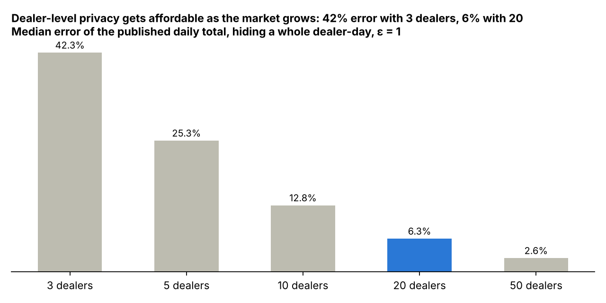
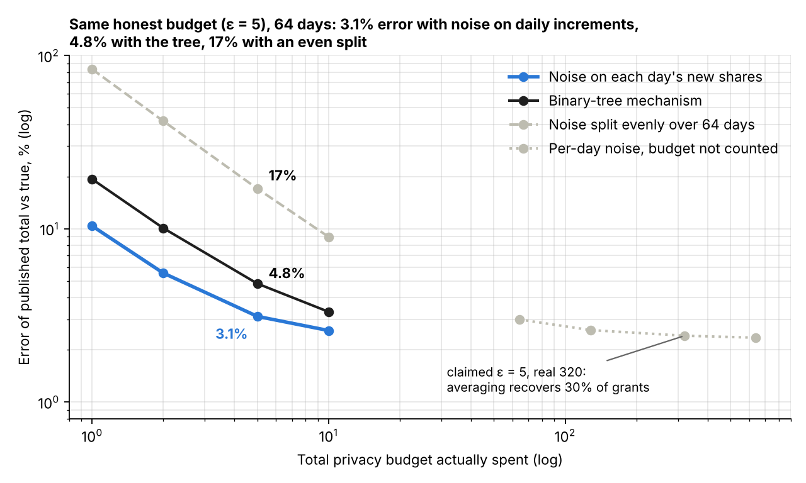
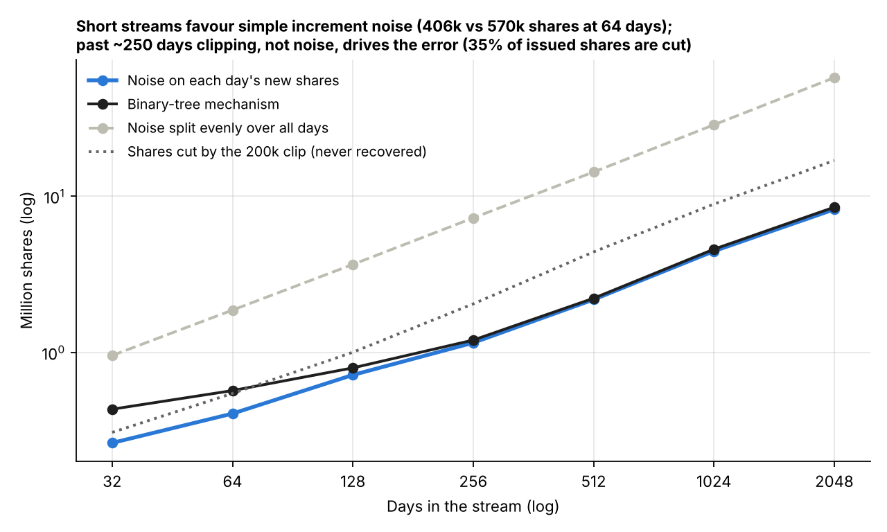
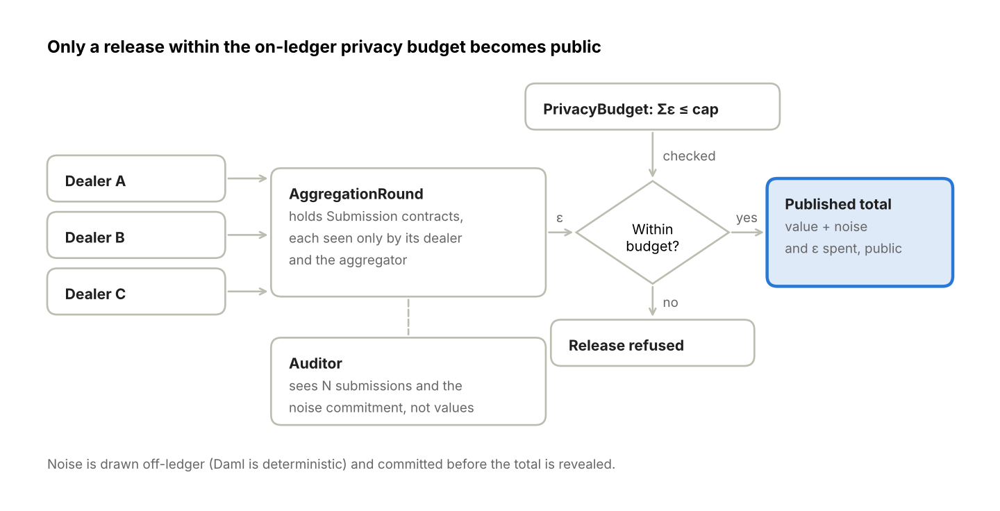

# Private Markets, Public Numbers: Thresholds and Differential Privacy for Aggregates on Canton

Draft, Nov 14, 2026 · Denis

## TL;DR

On a thin private market, publishing "only totals" is not private: two of three dealers who compare notes recover the third dealer's daily volume on every day. Two tools fix this, and they fit different cases. Where contributors are few and each knows its own share of the total, as with dealer volumes, only differential privacy bounds the leak, and "ε = 1" means very different protection depending on what it protects: hiding single trades costs a median error of 6.3% yet still exposes the day of a dealer making ~20 trades 42% of the time, while hiding whole dealer-days cuts exposure to 5.7% at a median error of 43% with three dealers (6.3% with twenty). Where contributors are many and the reader is an outsider, as with a share count summed over many cap tables, a threshold does better: moving the published total only when five changes are pending costs 0.4% with 20 registers and leaves an outsider nothing, while DP at ε = 5 costs 9%. In both cases the rule must cover the level and not only the change, and a noise budget must be enforced, which on Canton belongs in a Daml contract.

## 1. The problem: totals leak on thin markets

A total reveals any single contribution to everyone who knows all the others. Canton's sub-transaction privacy hides each trade from non-participants, but markets still need public signals: volume, supply, price. The 2026–2028 Dev Fund roadmap names this tension directly in its *Public verifiability* RFP: an issuer-published aggregate may not be trusted, and disclosing private transactions defeats confidentiality.

Take a tokenized bond traded by three dealers, A, B and C. The market publishes one number a day, total volume.

| Day | Published total | A knows its own | A learns about B + C | A learns about C alone |
| --- | --- | --- | --- | --- |
| Monday | 18.0M | 6.0M | 12.0M | – |
| Tuesday (A knows B did not trade) | 11.5M | 5.0M | 6.5M | **6.5M, exactly** |

No one disclosed anything, yet A now knows C's Tuesday volume. With two colluding dealers no absence is even needed: total minus their own volumes is the third dealer's volume, every day. Statistical agencies hit the same wall: reconstruction of individual records from published tables is why the 2020 US Census adopted differential privacy.

### Why now: two proposals, two different answers

Two current proposals under the same RFP publish Canton aggregates. One has an inference rule, the other does not mention one.

| Proposal | What it publishes | How it is checked | Inference protection |
| --- | --- | --- | --- |
| [Canton Asset Data Feed](https://github.com/canton-foundation/canton-dev-fund/pull/890) (Fairmint with Blockworks; 2.4M CC requested) | first feed: private-company equity as one daily aggregate across every register Fairmint operates (shares outstanding, shares issued, holders, valuation); public, no account needed | each daily snapshot is anchored on Canton as a Merkle root; the proposal says the anchor does not show the values are correct | yes: no company-level item, a suppression rule on daily changes (`min-count-5` in the example), no holder ids or single positions, and a "privacy floor" acceptance condition |
| [Attested metrics feed](https://forum.canton.network/t/attested-metrics-feed-for-canton-assets-rfp-11-public-verifiability-seeking-feedback-champion/9093) (ZWING) | supply, issuance, volume of issuer assets | proof computed on the issuer's own node, commitment on the Global Synchronizer | none in the forum post |

So the question is no longer whether aggregates need protection, but which rule protects what. A threshold such as `min-count-5` and calibrated noise are different tools. This article measures both: noise on a market with few contributors (sections 2–4), and a threshold against noise on the design the CADF proposal describes (section 4, last part).

## 2. Measuring the leak

Exact daily totals expose a competitor's volume on 100% of days to a two-dealer coalition and on ~49% of days to a single insider who knows which dealers were absent. These numbers come from a synthetic market, because real volumes on Canton's private markets are, by design, not public.

| Parameter | Value |
| --- | --- |
| Dealers | 3 (varied 3–50 in section 4) |
| Period | 22 trading days |
| Trades per dealer per day | Poisson, mean 20 |
| Trade size | log-normal, median 250k USD, capped at 5M |
| Resulting volume | ~6.9M per dealer-day, ~20.7M per market-day |
| Repetitions | 200 random markets per data point |

Throughout, a volume or a grant counts as **recovered** (or a dealer's day as **exposed**) when the attacker's estimate lands within ±10% of the true value.

Two attacks on exact publication:

- **Coalition attack.** Two dealers subtract their own volumes from the total. Recovery of the third dealer's daily volume: 100% of days.
- **Single insider, sparse market.** Dealers trade on 60% of days. On days when only one other dealer traded, the insider's residual is that dealer's volume exactly: 49% of days. This assumes the insider knows who was absent, which on a three-dealer market is often visible from quotes or chat, but it is an assumption.

The coalition attack is the standard threat model of differential privacy ("everyone but the victim colludes"), so sections 3 and 4 measure defences against it.

## 3. Differential privacy in one page

Differential privacy adds noise calibrated so that any one participant's data barely changes what is published. The Laplace mechanism releases

$$\tilde{f}(x) = f(x) + \mathrm{Lap}(b), \qquad b = \frac{\Delta}{\varepsilon}, \qquad \sigma_{\text{noise}} = \sqrt{2}\, b$$

where Δ (sensitivity) is the most one protected unit can change the total, and ε is the privacy parameter: smaller means more private and noisier. Example: Δ = 1M USD, ε = 1 gives b = 1M and a noise standard deviation of about 1.41M.

The decisive choice is the **privacy unit**, which fixes Δ:

| Privacy unit | What stays hidden | Sensitivity Δ used here |
| --- | --- | --- |
| Trade | whether any single trade happened, and its size | 1M (trades clipped at 1M) |
| Dealer-day | a dealer's entire volume for the day | 12M (dealer-days clipped at 12M) |

Clipping bounds every contribution before summing, so Δ holds by construction; the clipping rule is public and costs some accuracy on unusually large trades.

The two units are linked by group privacy: a guarantee of ε for one trade gives at most k·ε for a dealer who makes k trades a day. At 20 trades a day, trade-level ε = 1 is a dealer-day guarantee of up to ε = 20.

Three more properties matter on a ledger. Releases about the same data compose: k releases at ε each cost k·ε in total, so a *privacy budget* caps the sum. Releases about disjoint data do not add up: a daily total at ε = 1 costs each trade ε = 1 however long the feed runs, because every trade sits in one day only. And the guarantee holds against attackers who know everything else, including all other dealers' data, which is exactly the coalition from section 2.

## 4. Results

All errors below are medians measured against the true, unclipped totals; half of the releases are worse. A dealer's exposure depends on how large the noise is relative to its volume: both privacy units trace the same curve while noise dominates, and the unit only decides where "ε = 1" lands on it. Clipping adds a floor: trade-level releases cannot get closer than about 4% to the true total, because trades above the 1M bound are cut.



*Figure 1. canton-dp-aggregates, experiment E2 · synthetic market, 200 runs per point.*

| ε = 1, daily, 3 dealers | Median error | 90th-percentile error | Dealer-days exposed |
| --- | --- | --- | --- |
| Hide one trade (Δ = 1M) | 6.3% | 16% | 42% |
| Hide a dealer-day (Δ = 12M) | 43% | 133% | 5.7% |

Trade-level ε = 1 adds the same noise as dealer-level ε = 12, so for a dealer's day it is a weak guarantee in disguise. Choosing a setting is choosing one point on this curve, which is why the number to publish next to every release is the noise scale, not only ε.



*Figure 2. canton-dp-aggregates, experiment E4 · synthetic market, 200 runs per point.*

Dealer-level noise is fixed by one dealer's size, so it shrinks relative to the total as dealers are added.

**Release window.** Trade-level protection at ε = 1 drops from 6.1% error daily to 0.8% monthly, but only if the monthly release uses a larger clip bound (2M instead of 1M): the noise stays fixed while the total grows ~22 times, whereas clipping bias grows with it. Protecting a dealer's whole month gains nothing from the longer window: the protected unit and the total both grow 22 times, and the error stays where it was (36% monthly, 42% daily, equal within sampling noise).

**Averaging attack.** If the same daily total can be re-queried with fresh noise, the attacker's error falls from 960k USD after one query to 486k after 5 and 114k after 100, the √k law. A budget of Σε ≤ 5 refuses the sixth query.

### Running totals: the supply case

A feed that publishes a running total every day leaks each new entry as the difference between two days; with exact snapshots every entry is recovered. Setup, for one issuer: 10M shares outstanding, new grants on ~15% of days with a median of 100k shares, 64 daily snapshots, privacy unit "one grant" clipped at 200k, ε = 5.



*Figure 3. canton-dp-aggregates, experiment E6 · synthetic cap table, 200 runs per point.*

The tempting fix, fresh noise on each snapshot, looks cheap (2.4% error) but each grant sits in every later snapshot, so it spends up to 64 times the budget it claims, and averaging the snapshots recovers 30% of grants. Three mechanisms account for the budget honestly:

| Mechanism (total ε = 5) | Error vs total | Error in shares | Error vs shares issued | Grants recovered (day-over-day / averaging attack) |
| --- | --- | --- | --- | --- |
| Budget split evenly over 64 snapshots | 17% | 1.84M | 118% | 0.2% / 1.6% |
| Binary-tree mechanism (Dwork et al. 2010; Chan, Shi and Song 2011) | 4.8% | 529k | 34% | 1.9% / 2.1% |
| Noise on each day's new shares, then a running sum | 3.1% | 347k | 22% | 17% / 4.4% |

The simplest honest mechanism is the most accurate at this length: a grant touches one daily increment, so one Laplace draw per day costs ε for the whole stream. It is also the least noisy, so more grants are recovered under the same ε. The binary tree is the textbook answer for continual release, but its advantage is asymptotic.



*Figure 4. canton-dp-aggregates, experiment E9 · synthetic cap table, ε = 5, 100 runs per point.*

Two limits show up here, and both matter more than the choice of mechanism:

- **The base is public.** 4.8% of a roughly 11M total is 529k shares, a third of everything issued in the period. Relative to what the feed actually tracks, the error is large.
- **Clipping bias accumulates.** About a third of issued shares exceed the 200k bound. They are never added back, so the published total drifts below the truth without limit: 0.5M shares after 64 days, 8.9M after 1,024. Past roughly 250 days this bias, not noise, drives the error.

For the tree at 64 days, the clip bound trades the two against each other:

| Clip bound per grant | Error vs true total | of which clipping bias |
| --- | --- | --- |
| 50k | 5.4% | 5.3% |
| 100k | 4.5% | 3.9% |
| 200k (used above) | 4.8% | 2.3% |
| 500k | 9.7% | 0.7% |
| 1M | 19.1% | 0.2% |

The bound must come from public or earlier-period information, not from the data being released. The conclusion for a supply figure, which consumers usually need exact, is that noise is a poor fit.

### One aggregate over many registers: threshold against noise

The CADF proposal does not publish a per-company total. It publishes one aggregate across every register and applies a suppression rule to daily changes. Modelled with R registers, each with 0.15 grants a day, over 64 days:

| Registers | Rule | Error vs shares issued | Outsider | One register | Everyone but the target |
| --- | --- | --- | --- | --- | --- |
| 5 | exact level every day | 0% | 48% | 56% | 100% |
| 5 | level moves when 5 grants are pending | 6.1% | 0% | 0.4% | 100% |
| 5 | DP, ε = 5, clip 1M | 33% | 5.1% | 5.3% | 7.5% |
| 20 | exact level every day | 0% | 5.9% | 6.8% | 100% |
| 20 | level moves when 5 grants are pending | 0.4% | 0% | 0% | 100% |
| 20 | DP, ε = 5, clip 1M | 9.1% | 1.8% | 2.0% | 7.1% |
| 50 | DP, ε = 5, clip 1M | 4.0% | 0.3% | 0.3% | 6.9% |

*canton-dp-aggregates, experiment E10 · 200 runs per row. Columns 4–6: share of grants recovered by an attacker who knows nothing, who operates one register, or who knows every other grant.*

Three readings:

- **A rule on the change alone protects nothing.** If the level is still published every day, the change is the difference of two levels. That is the "exact level" row: with five registers an outsider recovers 48% of grants.
- **A threshold on the level is close to free at scale.** Holding the level until five grants are pending stops an outsider and a single register almost completely and costs 0.4% with 20 registers. It does not bound a party that knows the other grants in a batch.
- **Noise bounds that party, at a price.** It is the only rule in the table that limits the coalition, and for a supply figure it needs dozens of registers before the error is tolerable.

So the two tools divide the ground. A threshold fits an aggregate with many independent contributors read by outsiders, which is the CADF equity design. Noise fits a total whose contributors are few and each knows its own share, which is the dealer market of section 2 and any volume metric on a thin asset.

### Do the conclusions depend on the assumptions?

Each scenario changes one assumption of the base case, with clip bounds set by a fixed public rule (4× the median trade, 2× the expected dealer-day, 2× the median grant) rather than tuned to the data; 100 runs per scenario.

| Conclusion | Range across 7 scenarios | Holds? |
| --- | --- | --- |
| Dealer-day ε = 1 rarely exposes a dealer's day (under 10%) | 4.0–5.4% of days | yes, everywhere |
| Dealer-day protection is far cheaper with 20 dealers than with 3 | 6–7× less error | yes, everywhere |
| The tree beats an evenly split budget for daily snapshots (ε = 5) | 2.2–4.7× less error | yes, everywhere |
| Unaccounted per-day noise leaks under averaging (claimed ε = 5) | 22–42% of grants | yes, everywhere |
| Trade-level ε = 1 still exposes a dealer's day (over 25%) | 15% at 5 trades/day, 41% at 20, 69% at 50; 9% with heavy tails | **fails in two scenarios** |

The first failure is what theory predicts: a guarantee for one trade covers a dealer who makes k trades a day only as k·ε, so the more a dealer trades, the less trade-level protection hides its day. The second is a limit of the simple clip rule: with heavy-tailed trade sizes (log-normal σ = 1.5) the 4×-median bound cuts so much that the published total is off by 38%, which hides the dealer and the market alike. Scaling every trade up or down changed nothing, a sanity check on the code.

## 5. Design for Canton

Canton already provides the hard part, private submission; Daml adds the piece most DP deployments lack, a budget kept on a ledger the operator does not control alone.



*Figure 5. Proposed Daml design · 4 contracts, 1 check. Only a release within the on-ledger privacy budget becomes public.*

Each dealer creates a `Submission` visible only to itself and the aggregator, using Canton's sub-transaction privacy as is. A release is a choice on `AggregationRound` that must also exercise `PrivacyBudget`: if the cumulative ε would pass the cap, the ledger rejects the transaction.

Four design points:

- **What the budget covers.** One `PrivacyBudget` per protected dataset: a trading day for a daily volume, the whole stream for a running total. Daily totals over different days do not draw on the same budget; repeated or corrected releases of the same day do.
- **Who can change it.** The dealers are signatories of `PrivacyBudget`, so the aggregator cannot archive it and start a fresh one over the same data.
- **Randomness.** Daml execution is deterministic, so noise is generated off-ledger. The aggregator commits to a hash of the noise seed before the round opens for submissions, so it cannot pick a seed after seeing the data; a seed combined from several parties would remove even that trust.
- **What the ledger does not check.** The contract enforces the ε that was declared, not the noise that was actually added, and DP does not prove the aggregator summed honestly. An auditor who is given the seed and observer rights on the submissions can recompute a release, and by doing so learns the exact total, so that auditor sits inside the trust boundary. Without such an auditor, correctness needs a TEE or zero-knowledge attestation, the stronger options the RFP lists; an attested feed such as ZWING's could prove that the published figure is the true aggregate plus noise from a committed seed.

A threshold rule fits the same contracts with no noise at all: the release choice checks the number of pending contributions instead of the remaining budget.

## 6. Recommendations

Match the rule to who contributes and who reads.

1. **Protect the level, not only the change.** A suppression rule on a daily change item does nothing if the level is published every day.
2. **Many independent contributors, outside readers: use a threshold on the level.** With 20 registers, releasing when five changes are pending costs under 1% and leaves an outsider nothing.
3. **Few contributors who each know their share: use DP.** A threshold cannot help when the reader is a contributor. For daily volumes, trade-level ε ≈ 1 costs about 6% median error on a three-dealer market; state the privacy unit next to the number, and remember it protects a busy dealer's day only weakly.
4. **Dealer-level DP: markets with ≥ 20 participants.** Below that, noise swamps a daily figure, and a longer window does not help.
5. **Avoid noise on figures that must be exact.** For supply, clipping bias accumulates; prefer thresholds, delay, or access control.
6. **Enforce a privacy budget on-ledger, and publish the mechanism, ε and clipping bounds with every release.** Consumers can then size their own error bars, and the Foundation can set network-wide defaults.

## 7. Limitations and next steps

The results are directional: they come from synthetic data, not from Canton.

- **Synthetic data.** Trade counts, grant rates and sizes are assumptions. The robustness check shows which conclusions survive seven alternative markets. Calibrating against real orders of magnitude (number of registers, grant frequency, dealers per asset) is the most valuable next step.
- **One threshold rule.** Only "five pending changes" was modelled. A count threshold does not guard against one dominant contribution, and other metrics (a valuation sum that moves on a single priced round) need their own analysis.
- **Basic composition only.** Advanced composition or Rényi DP would stretch the same budget over more releases.
- **Attacks are lower bounds.** The recovery rates are for the attacks tried here; the ε guarantee is what holds against all of them.
- **Honest aggregator assumed.** Neither rule proves the computation was correct.

Next: share these results with the CADF and ZWING teams, and build a Daml reference implementation (`Submission`, `AggregationRound`, `PrivacyBudget`, `PublishedAggregate`) with Daml Script tests on DevNet.

## Disclosure

[To complete before publishing: any Canton Coin holdings; the plan to submit an open-source proposal under the *Public verifiability* RFP; how AI tools were used in the analysis and drafting; no sponsorship from the teams discussed.]

## Appendix: reproducibility and sources

Every number above is produced by one command, in about 15 seconds:

```
git clone https://github.com/DeniKram/canton-dp-aggregates && cd canton-dp-aggregates
pip install -e ".[dev]" && pytest
PYTHONPATH=src python -m cdp.experiments --out results --seeds 200
python article/make_figures.py        # redraws the figures of this article
```

Modules: `data.py` (market generator), `dp.py` (clipping, Laplace mechanism, budget accountant), `attacks.py` (coalition, sparse-insider, averaging and snapshot attacks), `captable.py` (cap-table model, binary-tree and increment-noise continual release), `registers.py` (one aggregate over many registers, threshold and DP release rules), `sensitivity.py` (robustness scenarios), `experiments.py` (E1–E10, CSV and figures). Licence Apache-2.0.

Sources:

- [Canton Foundation, 2026–2028 Strategic Roadmap and RFPs](https://github.com/canton-foundation/canton-dev-fund) — *Public verifiability* RFP
- [Canton docs: privacy model](https://docs.canton.network/appdev/deep-dives/privacy-model)
- [Canton Community Research Grants announcement](https://canton.foundation/introducing-the-canton-community-research-grants/)
- Dwork, McSherry, Nissim, Smith (2006), *Calibrating Noise to Sensitivity in Private Data Analysis* — the Laplace mechanism
- Dwork and Roth (2014), *The Algorithmic Foundations of Differential Privacy* — composition
- Dwork, Naor, Pitassi, Rothblum (2010), *Differential Privacy Under Continual Observation*; Chan, Shi, Song (2011), *Private and Continual Release of Statistics* — binary-tree mechanism
- [Canton Asset Data Feed proposal, PR #890](https://github.com/canton-foundation/canton-dev-fund/pull/890), file `rfps/financial-markets-standards-verification/2026-10-Fairmint-canton-asset-data-feed.md`, read in full on Nov 14, 2026
- [ZWING, Attested metrics feed for Canton assets](https://forum.canton.network/t/attested-metrics-feed-for-canton-assets-rfp-11-public-verifiability-seeking-feedback-champion/9093)
